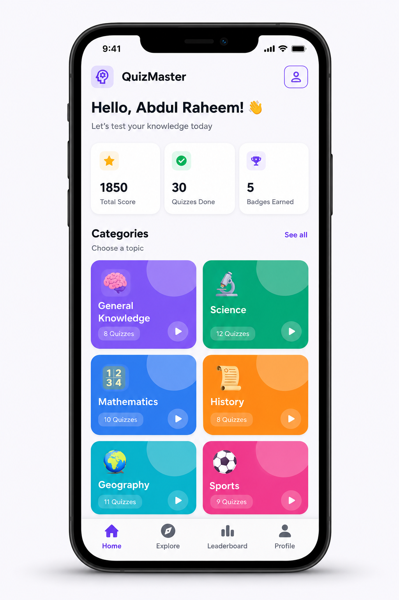
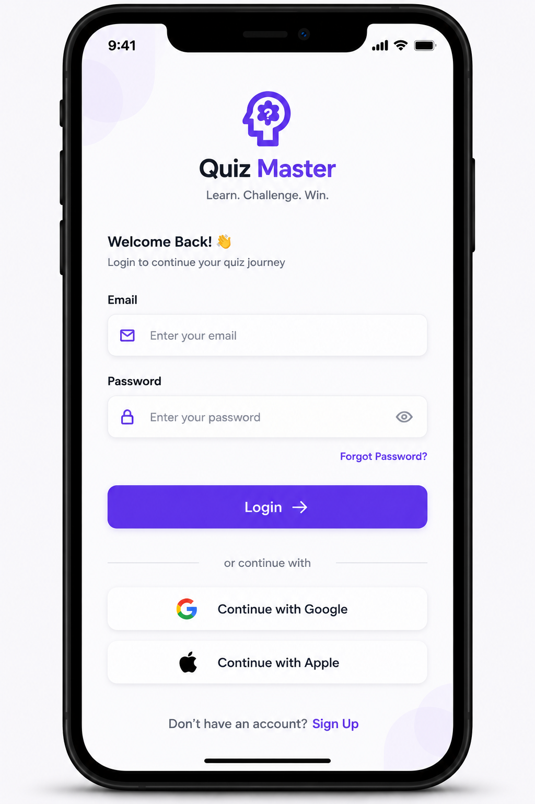
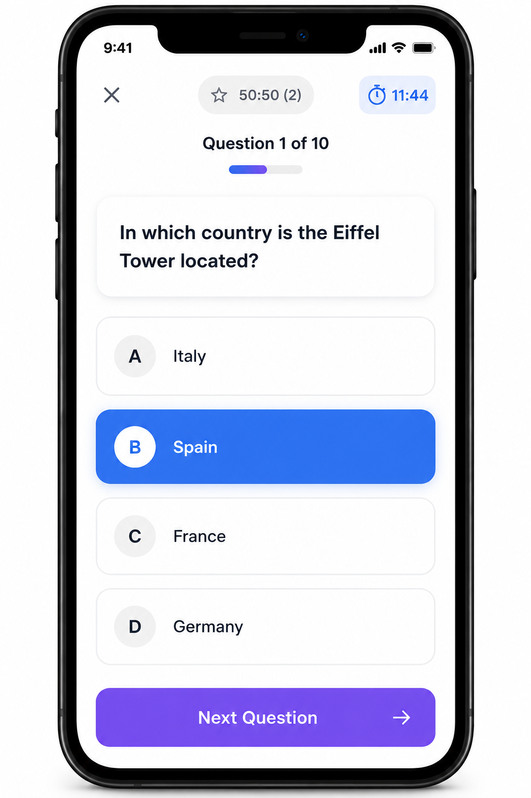
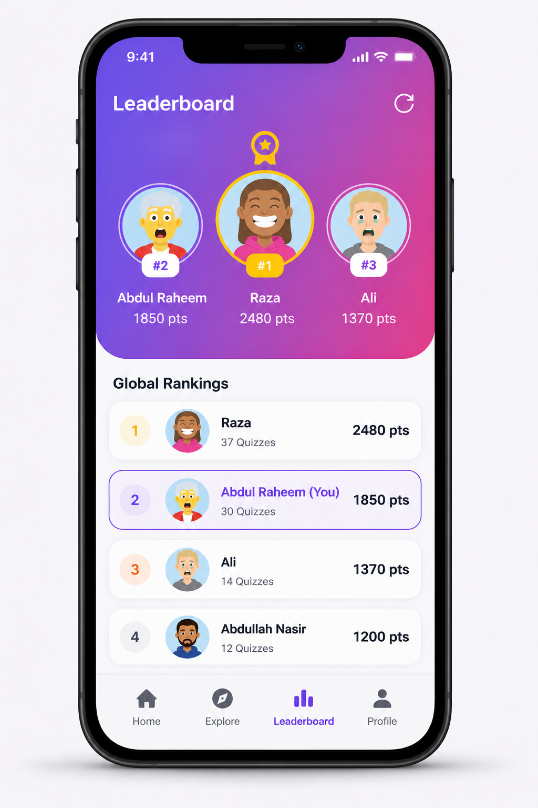
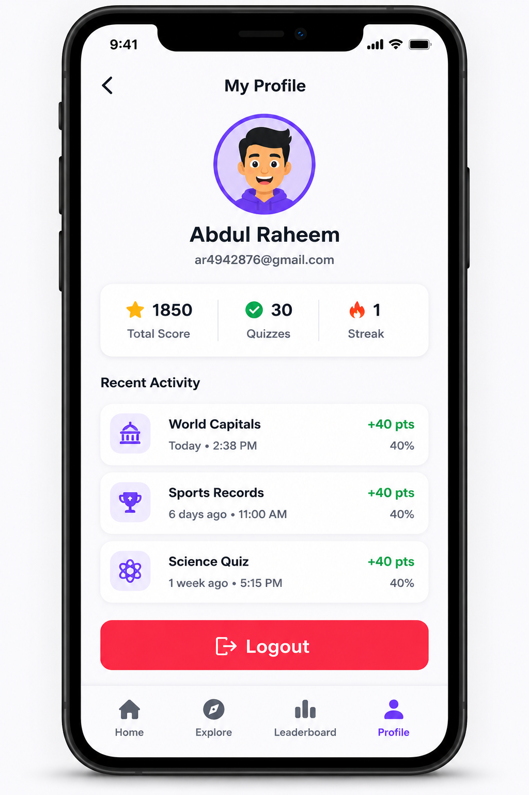

# 📚 Quiz Master

A modern Flutter Quiz application built with **Flutter**, **Firebase**, and **GetX**.

---

## ✨ Features

- 🔐 Firebase Authentication
- 📝 Multiple Quiz Categories
- 🏆 Leaderboard
- 👤 User Profile
- 📊 Score Tracking
- 🎨 Beautiful Modern UI
- ⚡ GetX State Management

---

## 🛠 Tech Stack

- Flutter
- Dart
- Firebase Authentication
- Cloud Firestore
- GetX
- Shared Preferences

---


## Complete imgae

<image src="assets/whole.png"width="280"/>

## Dashboard



---

## Login



---

## Question Screen



---

## Leaderboard



---

## Profile



---


## 🚀 Installation Process

```bash
git clone https://github.com/AbdulRaheem4340/quiz-master.git

cd quiz-master

flutter pub get

flutter run
```

---

## 👨‍💻 Developer

**Abdul Raheem**

Flutter Developer